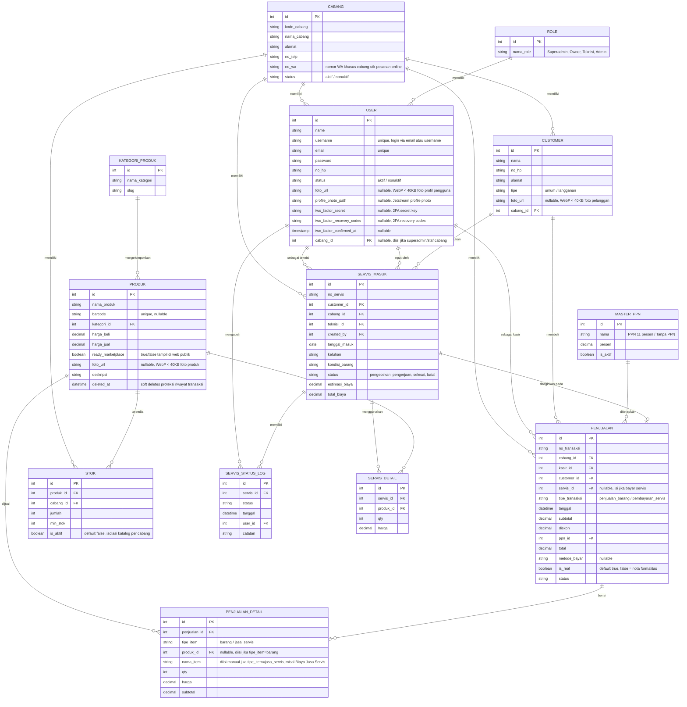

# Konteks Sistem: Aplikasi Servis, Kasir & Marketplace Multi-Cabang

Saya sedang membangun sebuah sistem internal untuk usaha servis elektronik (misal servis HP/laptop) yang punya **banyak cabang**. Sistem ini mencakup: manajemen servis masuk/keluar, kasir (POS), penjualan produk, dan marketplace publik yang terhubung ke WhatsApp. Berikut kebutuhan lengkap dan logika bisnis yang sudah disepakati.

---

## 1. Gambaran Umum & Role

Sistem digunakan oleh banyak cabang sekaligus, jadi ada **data master Cabang**. Setiap User terikat ke 1 cabang tertentu (kecuali **Owner** yang bisa akses semua cabang dan beralih konteks antara Kantor Pusat/HQ dan Cabang).

**Role & Hierarki Hak Akses:**
- **Owner (Pemilik Bisnis)** — Memegang otoritas tertinggi (level Organisasi/Pusat). Memiliki akses ke **HQ Context** dan seluruh cabang. Berhak menambah dan mengelola akun semua peran (**Owner baru**, **Superadmin**, **Teknisi**, **Admin**) di seluruh cabang maupun HQ, mengelola **Cabang baru**, mengatur **Tarif PPN**, serta melihat konsolidasi finansial/laporan performa seluruh cabang.
- **Superadmin (Admin Cabang)** — Administrator operasional cabang. Akses dibatasi ketat **hanya pada 1 cabang yang dipegangnya**. Dapat mengelola transaksi kasir, katalog produk cabang, stok, laporan cabang, dan **mengelola/membuat akun staf di cabangnya sendiri** (role **Superadmin**, **Teknisi**, dan **Admin** khusus untuk cabangnya). Superadmin **tidak bisa** menambah cabang baru, beralih ke cabang lain, mengelola akun Owner, atau mengelola staf di cabang lain.
- **Teknisi** — Akses menu servis (servis masuk, servis keluar, ubah status pengerjaan) serta pencatatan data pelanggan pada cabang yang ditugaskan.
- **Admin (Staf POS / Kasir)** — Akses menu kasir POS/penjualan produk, penagihan servis, riwayat transaksi, dan data pelanggan pada cabang yang ditugaskan.

---

## 2. Fitur Customer (Publik)

- **Menu publik cek status servis** — customer bisa cek status servisnya (pengecekan / pengerjaan / selesai) tanpa login, misal pakai No. Servis.
- **Menu marketplace/pembelian produk** — customer browsing produk yang memang sengaja ditampilkan ke publik, masukkan ke keranjang, lalu pesan lewat WhatsApp (bukan checkout online biasa, tapi generate rincian pesanan yang dikirim ke WA).

### Logika marketplace multi-cabang (penting):
- Produk adalah **katalog global** (1 produk = 1 baris data, dipakai semua cabang) — bukan produk per cabang, supaya tidak duplikat & mudah dikelola.
- Produk punya kolom `ready_marketplace` (true/false) — keputusan admin pusat, produk mana yang boleh tampil di web publik.
- Stok tiap produk **berbeda-beda per cabang**, dicatat di tabel stok terpisah yang menghubungkan produk + cabang + jumlah + status keaktifan (`is_aktif`).
- Saat customer lihat produk di web, sistem menampilkan **ketersediaan stok per cabang** (misal: "Ready di Cabang Pangkalpinang: 5 pcs", "Cabang Sungailiat: 0 pcs").
- **Customer wajib memilih cabang** sebelum kirim pesan ke WA (bukan otomatis pilih cabang terdekat — itu fitur lanjutan yang belum digarap). Setelah pilih cabang, sistem generate link WA ke **nomor WA milik cabang tersebut** (jadi setiap cabang punya nomor WA sendiri di data master Cabang), berisi rincian pesanan (nama produk, qty, harga, total estimasi).
- Hanya menampilkan stok dari **cabang yang berstatus aktif** dan produk dengan `is_aktif = true`. Cabang yang tutup/nonaktif tidak boleh muncul di pilihan marketplace.
- Pesanan via WA ini **tidak disimpan sebagai transaksi di database** (cukup teks terkirim ke WA) — nanti kalau customer jadi beli, kasir yang input manual ke transaksi kasir.

---

## 3. Fitur Servis Masuk

- Form input servis baru: pilih **Customer** — bisa pilih dari data lama (sudah pernah servis sebelumnya) atau input Customer Baru.
- Setelah input, bisa **cetak Tanda Terima Servis** untuk diberikan ke customer (pakai printer thermal/dot matrix, ukuran struk — referensi printer Epson LX-310).
- Servis punya **status** yang bisa diubah: `pengecekan` -> `pengerjaan` -> `selesai` (atau `batal`).
- Setiap perubahan status **dicatat sebagai log** (siapa yang ubah, kapan, status apa) — untuk histori/audit trail, bukan cuma overwrite status terakhir.
- Servis bisa punya detail sparepart yang dipakai (misal ganti LCD, ganti baterai) dengan qty & harga masing-masing — ini yang nanti dipakai untuk hitung total biaya servis.

## 4. Fitur Servis Keluar

- Bukan tabel terpisah — ini adalah **filter/list dari data Servis Masuk** yang statusnya sudah `selesai` (siap diambil/dibayar).
- Ada tombol **Batal** — kalau dipencet, status servis jadi `batal` dan **total biaya dikosongkan** (di-reset ke 0 / null).
- Begitu servis sudah ditagihkan lewat kasir (lihat poin 5), servis tersebut **otomatis terkunci** — tidak bisa ditagih dobel oleh kasir lain/shift lain. Kalau dicari lagi di kasir, sistem harus tolak dengan pesan semacam "servis ini sudah dibayar".

---

## 5. Fitur Kasir Produk & Penagihan Servis (Terpisah, Bukan Digabung Lagi)

> **Update keputusan:** sebelumnya sempat direncanakan 1 menu Kasir gabungan dengan search bar pintar. Sekarang diputuskan **dipisah** jadi 2 titik masuk yang beda, karena servis dan penjualan produk butuh alur & konteks yang beda:

### A. Kasir Produk (menu tersendiri)
- Kasir cari barang -> masuk keranjang -> bayar (diskon + PPN) -> cetak nota.
- Ini murni transaksi jual-beli barang biasa, tidak ada kaitan dengan servis.
- Mendukung **Penjualan Non-Real (Nota Formalitas)**: mode cetak struk tanpa memotong stok dan tanpa masuk ke pembukuan finansial / dashboard.

### B. Penagihan Servis (masuk dari Index/List Servis, BUKAN dari menu Kasir)
- Kasir/Teknisi buka **Index Servis** — daftar semua servis, bisa difilter per status (`pengecekan`, `pengerjaan`, `selesai`, `batal`).
- Servis yang statusnya **`selesai`** akan punya tombol/aksi **"Tagih & Cetak"** langsung di baris itu.
- Begitu diklik, muncul form ringkas: rincian biaya servis (dari `SERVIS_DETAIL` + `total_biaya`), input **diskon**, pilih **PPN** (dari master PPN), lalu **Bayar** -> langsung cetak nota.
- Setelah dibayar, status servis otomatis berubah (misal jadi `sudah_dibayar` / `selesai_diambil`) dan **terkunci** — tidak bisa ditagih ulang oleh siapapun.

### Penomoran Transaksi — Format Harian & Tampilan Frontend
Nomor transaksi (`no_transaksi` di tabel `PENJUALAN`) menggunakan generator urutan harian per cabang (`YYMMDD`):
- **Backend Servis:** `INV-SV-[KODE_CABANG]-[YYMMDD]-[00001]` -> **Frontend:** `SV-[YYMMDD]-[00001]`
- **Backend Produk:** `INV-PJ-[KODE_CABANG]-[YYMMDD]-[00001]` -> **Frontend:** `PJ-[YYMMDD]-[00001]`

Keduanya tetap masuk ke tabel `PENJUALAN` yang sama, dibedakan lewat kolom `tipe_transaksi` dan prefix nomor transaksi.
Nomor invoice ditampilkan ke kasir/pelanggan secara ringkas (`PJ-YYMMDD-00001`) melalui model accessor `getNoTransaksiFrontendAttribute()`.

**Catatan implementasi:** counter nomor urut harian per jenis disimpan di tabel `NOMOR_URUT_TRANSAKSIS` dengan kolom `cabang_id`, `tipe`, `tanggal` (atau format `y-m-d`), `last_number` dibungkus `DB::transaction()` + row lock.

---

## 6. Fitur Penjualan (Laporan)

- Menu untuk **melihat/laporan data penjualan** (transaksi dari kasir) — beda dari "master servis". Ini murni tampilan histori transaksi kasir: filter tanggal, cabang, kasir, filter `is_real` (penjualan asli vs non-real), dsb.

## 7. Fitur Histori Servis (Laporan)

- Sama seperti fitur Penjualan di atas, tapi khusus untuk data servis — riwayat servis masuk sampai selesai/batal per customer/cabang/teknisi.

---

## 8. Data Master yang Dibutuhkan

- **Cabang** (`/master/cabang`) — Termasuk nomor WA khusus per cabang & status aktif/nonaktif (data cabang tidak boleh dihapus permanen karena berkaitan dengan histori transaksi lama — pakai status, bukan delete). Akses: Owner.
- **Role & Manajemen Pengguna** (`/master/users`) — Mengelola akun Owner, Superadmin, Teknisi, dan Admin dengan otorisasi bertingkat (Owner = global, Superadmin = staff cabang).
- **Kategori Produk** (`/master/kategori`) — Pengelompokan produk dengan proteksi hapus jika masih memiliki relasi produk. Akses: Owner & Superadmin.
- **Master Produk** (`/master/produk`) — Katalog global terpusat dengan matriks stok multi-cabang, barcode scanner, deteksi duplikasi instan, dan kompresi WebP. Akses: Owner & Superadmin.
- **Master PPN** (`/master/ppn`) — Opsi tarif pajak dinamis (`PPN 11%`, `PPN 12%`, `Tanpa PPN (0%)`) dengan proteksi hapus jika sudah tercatat di transaksi kasir. Akses: Owner.
- **Master Customer / Data Pelanggan** (`/master/customer`) — Data pelanggan disederhanakan murni menjadi Nama Pelanggan dan Nomor WhatsApp/HP (`nama`, `no_hp`), terisolasi per cabang dengan quick action WhatsApp langsung. Akses: Owner, Superadmin, Admin, Teknisi.
- **Nomor Urut Transaksi** — Generator counter atomik nomor invoice per cabang dan per jenis transaksi.

---

## 9. Skema Database (ERD) — format Mermaid

---

## 10. Keputusan Final atas Logika Bisnis & Penyesuaian Terkini

1. **Servis dibayar full lunas sekaligus** (tidak ada DP/cicilan). Relasi `SERVIS_MASUK` ke `PENJUALAN` tetap **one-to-one** seperti di skema — 1 servis hanya bisa punya 1 transaksi pembayaran.
2. **Data Customer bersifat per cabang** (bukan global lintas cabang). Pelanggan yang terdaftar di Cabang A terisolasi dari Cabang B — sesuai dengan `CUSTOMER.cabang_id` yang sudah ada di skema.
3. **Marketplace: pilih cabang manual vs auto-detect cabang terdekat.** Untuk versi sekarang tetap pakai **pilih cabang manual**.
4. **Reserve stok saat ada pesanan WA belum dikonfirmasi — tidak diperlukan.** Stok tetap baru berkurang saat transaksi resmi diproses di kasir.
5. **Penjualan Non-Real (Nota Formalitas / Dummy Invoice) di POS Kasir:**
   - Fitur untuk mencetak nota/struk dengan harga dan rincian tertentu atas permintaan pelanggan/kebutuhan administratif.
   - Transaksi non-real ditandai `is_real = false`.
   - **Stok barang TIDAK berkurang**.
   - **Dikecualikan dari seluruh perhitungan omset, laba, pendapatan bersih (nett), dan statistik performa dashboard**.
   - Kolom `metode_bayar` bersifat nullable dan disederhanakan.
6. **Isolasi Stok Multi-Cabang & Default Non-Aktif (`is_aktif = false`):**
   - Kolom `is_aktif` pada tabel `stoks` default `false`.
   - Saat Cabang A mendaftarkan produk baru, stok di Cabang B dan C otomatis berstatus non-aktif (0 stok) agar tidak mengotori katalog POS kasir cabang lain sebelum staf cabang bersangkutan mengaktifkannya.
   - Katalog Kasir POS hanya menampilkan produk dengan `is_aktif = true` di cabang yang sedang aktif.
7. **Standar Masking Format Rupiah (`Rp 17.000`):**
   - Seluruh input nominal uang (Harga Beli, Harga Jual, Diskon, Nominal Bayar) menggunakan format Rupiah dengan separator ribuan titik (`.`) di frontend via komponen Alpine.js `input-rupiah`, dengan tetap mengalirkan nilai numeric murni ke Livewire.
8. **Deteksi Duplikasi Produk Realtime (Smart Duplicate Detection):**
   - Saat input produk di modal Master Produk, sistem secara realtime mendeteksi apakah barcode atau nama produk sudah ada di master global. Jika ditemukan, sistem menampilkan notifikasi ramah & tombol 1-klik untuk langsung beralih ke mode edit/aktifkan produk di cabang saat ini.
9. **Hak Akses Pembuatan Akun Superadmin vs Owner:**
   - **Owner**: Berwenang membuat dan mengelola akun untuk semua peran (`Owner`, `Superadmin`, `Teknisi`, `Admin`) di seluruh cabang atau HQ.
   - **Superadmin**: Berwenang membuat dan mengelola akun staff khusus di cabangnya sendiri (`Superadmin`, `Teknisi`, `Admin`). Superadmin diblokir dari membuat akun `Owner` atau mengelola staff cabang lain.
10. **Branch Obfuscation untuk Peran Non-Owner (Superadmin, Admin, Teknisi):**
   - Pengguna selain Owner melihat dan mengalami sistem sebagai aplikasi toko tunggal ("Soulmate Komputer").
   - Seluruh elemen identifikasi cabang lain, badge nama cabang pada navbar/header, dropdown switcher cabang, dan keterangan cabang pada notifikasi disembunyikan/disterilisasi dari staf cabang.
11. **Pencarian Multi-Kata Longgar Global (Global Loose Multi-Word Search):**
   - Semua input pencarian (POS, Master Produk, Stok Cabang, Master User, Master Customer, Master Kategori) menggunakan mekanisme tokenized substring matching multi-kata (`explode(' ', $search)`), *case-insensitive* (`LOWER() LIKE ?`), dan non-strict per karakter.
12. **Aksi Hapus Produk di Cabang:**
   - Aksi hapus produk dari tampilan Cabang (oleh Superadmin) akan menonaktifkan status produk di cabang tersebut (`is_aktif = false`), bukan menghapus master produk global. Hapus master produk global hanya bisa dilakukan oleh Owner dalam Konteks HQ.

---

## 11. Penggunaan Barcode dalam Sistem

Barcode dipakai di **2 titik** dalam sistem ini, dan keduanya harus support **scanner fisik (USB/Bluetooth) + kamera HP/tablet**:

### A. Input Master Produk (oleh Admin/Superadmin)
- Saat tambah produk baru, admin scan barcode di kolom barcode.
- Sistem cek dulu ke database sendiri:
  - **Barcode sudah ada** -> muncul notifikasi deteksi duplikasi dengan 1-klik edit produk tersebut.
  - **Barcode belum ada** -> (opsional) coba lookup ke API eksternal (UPCItemDB) untuk auto-isi nama produk.
  - Kalau tetap tidak ketemu di manapun -> form kosong seperti biasa, admin isi manual.

### B. Cari Produk saat Transaksi Kasir Produk
- Kolom cari produk di Kasir jadi 1 pintu untuk 3 cara input: ketik nama manual, scan pakai scanner fisik, atau scan pakai kamera (tombol ikon kamera di sebelah kolom).
- Begitu barcode terdeteksi & cocok di database cabang -> produk **otomatis langsung masuk ke keranjang**.
- Kalau barcode tidak dikenali -> notifikasi "Barcode tidak dikenali", TIDAK membuka form tambah produk baru.

---

## 12. Halaman Display Papan Antrian Servis & Layanan Toko (Publik / Smart TV Monitor)
Halaman antarmuka publik tanpa login yang dirancang khusus untuk layar TV/Monitor toko di setiap cabang (`/display/{kode_cabang}`).
- Tampilan Dark Mode Neon Accent.
- Counter otomatis per kategori perangkat (Laptop, Printer, Komputer) dan sub-status (Pengecekan #0052FF, Pengerjaan #E6007A, Selesai #10B981).
- Realtime WebSocket updates via Reverb.

---

## 13. Struktur Navigasi Multi-Cabang & Hierarki Akses (HQ Context vs Branch Context)

Navigasi sistem dibagi menjadi **dua level konteks**:

### A. Konteks Global / Kantor Pusat (HQ View) — Khusus Owner
- Dashboard HQ (Konsolidasi Finansial & Omzet).
- Master Cabang (`/master/cabang`).
- Master Pengguna (`/master/users`).
- Master Produk (`/master/produk`).
- Master Kategori (`/master/kategori`).
- Master Tarif PPN (`/master/ppn`).
- Data Pelanggan Global (`/master/customer`).

### B. Konteks Operasional Cabang (Branch View)
- Dashboard Cabang (Single-store view "Soulmate Komputer" untuk non-owner).
- Layanan Servis (Servis Masuk, Servis Selesai/Keluar).
- Kasir POS Produk (`/kasir/produk`) & Riwayat Transaksi.
- Katalog & Stok: Master Produk, Master Kategori, Stok Cabang (`/cabang/stok`), Data Pelanggan (`/master/customer`).
- Staff & Akun: Manajemen Staff (`/master/users` - Superadmin & Owner mode cabang).

---

## 14. Kebijakan Master Produk, Foto Profil Pengguna & Kompresi Media WebP

- **Auto-WebP Compression:** Semua unggahan gambar produk, foto profil pengguna, dan foto pelanggan dikonversi otomatis ke format **`.webp`** dengan kompresi $\le 40\text{ KB}$.
- **Soft Deletes:** Tabel `produks` menggunakan `SoftDeletes` (`deleted_at`). Hanya akun **Owner dalam Konteks HQ** yang dapat melakukan hapus produk master, dengan proteksi jika produk memiliki riwayat transaksi.
- **Proteksi Hapus Kategori:** Kategori yang masih menaungi produk dilarang dihapus.
- **Indikator Stok Visual:** Peringatan multi-titik (pill badge HABIS / KRITIS, floating indicator pada thumbnail, highlight sisa fisik).

---

## 15. Modul Kasir POS Penjualan Produk (`/kasir/produk`)

- **Pencarian Cepat & Barcode Scanner:** Live input autofocus scan barcode / nama produk dengan loose multi-word search.
- **Layout Keranjang Ergonomis:** Nama produk ditampilkan penuh, subtotal harga item diletakkan di bawah nama produk, dan area checkout dibuat fixed/sticky scroll internal.
- **Validasi Stok Realtime:** Kuantiti barang dibatasi sisa stok fisik cabang aktif (`stok_max`).
- **Kalkulasi Diskon & PPN Dinamis:** Diskon (Rp) dan tarif pajak dari `master_ppns`.
- **Manajemen Pelanggan Fleksibel:** Transaksi Pelanggan Umum vs Pelanggan Terdaftar (modal tambah pelanggan baru ringkas: Nama & No. WA).
- **Multi-Metode Pembayaran:** Tunai (nominal bayar fleksibel), QRIS, Transfer Bank, dan toggle Penjualan Non-Real.
- **Integritas Data Atomic:** Nomor invoice atomik harian `INV-PJ-[KODE_CABANG]-[YYMMDD]-[NOMOR_URUT]` (frontend: `PJ-[YYMMDD]-[NOMOR_URUT]`) dengan row lock.
- **Cetak Struk Thermal:** Format nota struk standar 58mm / 80mm dengan jarak kuantiti-unit yang rapi (`1 UNIT`).

---

## 16. Sistem Autentikasi & Manajemen Akun Terpadu (Laravel Jetstream Livewire)

- **Engine Autentikasi**: Laravel Jetstream + Laravel Fortify stack Livewire.
- **Metode Login Fleksibel (Username atau Email)**:
  - Input login menerima alamat **Email** maupun **Username**.
  - Pengecekan status akun aktif (`status == 'aktif'`). Akun yang dinonaktifkan ditolak secara otomatis dengan pesan informatif.
  - Inisialisasi otomatis sesi `active_branch_id` saat login sukses berdasarkan data cabang pengguna.
- **Registrasi Publik Dinonaktifkan**:
  - `Features::registration()` dinonaktifkan di `config/fortify.php`.
  - Akun baru hanya dapat didaftarkan secara berjenjang melalui Master Pengguna (`/master/users`) oleh **Owner** (global semua cabang/role) atau **Superadmin** (khusus staf cabangnya).
- **Halaman Profil Pengguna Terintegrasi (`/user/profile`)**:
  - **Hero Overview Card**: Foto profil/inisial avatar, nama lengkap, username (`@username`), badge role (`Owner HQ`, `Superadmin`, `Teknisi`, `Admin`), cabang tugas, email, nomor WhatsApp, serta indikator status perlindungan 2FA.
  - **Tab 1 — Informasi Profil & Kontak**: Ubah nama lengkap, username (info read-only dari admin), email, nomor WhatsApp/HP, serta upload/hapus foto profil.
  - **Tab 2 — Perbarui Kata Sandi**: Kata sandi saat ini, baru, dan konfirmasi dilengkapi tombol *show/hide password toggle* dan tips keamanan.
  - **Tab 3 — Otentikasi Dua Faktor (2FA)**: Aktivasi 2FA via Google/Microsoft Authenticator, frame SVG QR code, pill kunci manual (*Setup Key*) dengan tombol salin, verifikasi OTP 6-digit, serta grid kode pemulihan darurat (*Recovery Codes*) dengan tombol salin semua.
  - **Tab 4 — Sesi Perangkat & Browser**: Monitoring sesi aktif di perangkat lain dengan deteksi OS (Windows, macOS/iOS, Linux, Android) & browser, IP address, waktu aktif, badge *Perangkat Ini*, serta tombol *Keluarkan Sesi Perangkat Lain*.
  - **Tab 5 — Zona Bahaya**: Opsi hapus akun permanen terlindungi konfirmasi kata sandi.
- **Sinkronisasi Foto Profil**:
  - Method accessor `getProfilePhotoUrlAttribute()` pada model `User` secara cerdas memprioritaskan `profile_photo_path` (Jetstream) dan `foto_url` (upload Master Pengguna WebP $\le 40\text{ KB}$), dengan fallback inisial SVG avatar.
- **Desain Solid Clean Anti-AI Slop**:
  - Warna solid: Brand Purple (`#5E17EB`), Tech Blue (`#0052FF`), Accent Pink (`#E6007A`), neutral slate/gray, kartu putih dengan border crisp, dan typography *Plus Jakarta Sans*.