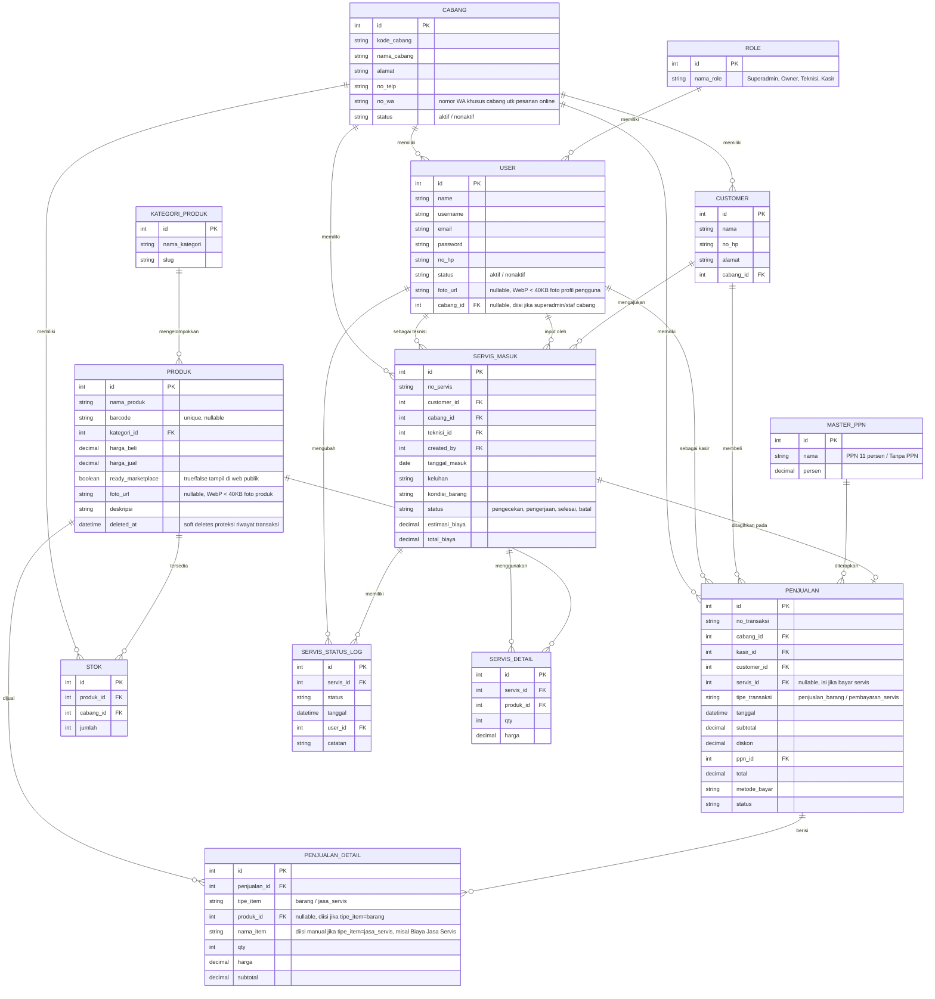

# Konteks Sistem: Aplikasi Servis, Kasir & Marketplace Multi-Cabang

Saya sedang membangun sebuah sistem internal untuk usaha servis elektronik (misal servis HP/laptop) yang punya **banyak cabang**. Sistem ini mencakup: manajemen servis masuk/keluar, kasir (POS), penjualan produk, dan marketplace publik yang terhubung ke WhatsApp. Berikut kebutuhan lengkap dan logika bisnis yang sudah disepakati.

---

## 1. Gambaran Umum & Role

Sistem digunakan oleh banyak cabang sekaligus, jadi ada **data master Cabang**. Setiap User terikat ke 1 cabang tertentu (kecuali **Owner** yang bisa akses semua cabang dan beralih konteks antara Kantor Pusat/HQ dan Cabang).

**Role & Hierarki Hak Akses:**
- **Owner (Pemilik Bisnis)** — Memegang otoritas tertinggi (level Organisasi/Pusat). Memiliki akses ke **HQ Context** dan semua cabang. Satu-satunya role yang berhak menambah/mengelola **Owner baru**, **Superadmin**, dan **Cabang baru**, serta melihat konsolidasi finansial/laporan performa seluruh cabang.
- **Superadmin (Admin Cabang)** — Administrator operasional cabang. Akses dibatasi ketat **hanya pada 1 cabang yang dipegangnya**. Dapat mengelola transaksi, stok, teknisi, kasir, dan laporan di cabangnya, tetapi **tidak bisa** menambah cabang baru, beralih ke cabang lain, atau mengelola akun Owner/Super Admin lain.
- **Teknisi** — Akses menu servis (servis masuk, servis keluar, ubah status pengerjaan) pada cabang yang ditugaskan.
- **Kasir** — Akses menu kasir POS/penjualan produk dan penagihan servis pada cabang yang ditugaskan.

---

## 2. Fitur Customer (Publik)

- **Menu publik cek status servis** — customer bisa cek status servisnya (pengecekan / pengerjaan / selesai) tanpa login, misal pakai No. Servis.
- **Menu marketplace/pembelian produk** — customer browsing produk yang memang sengaja ditampilkan ke publik, masukkan ke keranjang, lalu pesan lewat WhatsApp (bukan checkout online biasa, tapi generate rincian pesanan yang dikirim ke WA).

### Logika marketplace multi-cabang (penting):
- Produk adalah **katalog global** (1 produk = 1 baris data, dipakai semua cabang) — bukan produk per cabang, supaya tidak duplikat & mudah dikelola.
- Produk punya kolom `ready_marketplace` (true/false) — keputusan admin pusat, produk mana yang boleh tampil di web publik.
- Stok tiap produk **berbeda-beda per cabang**, dicatat di tabel stok terpisah yang menghubungkan produk + cabang + jumlah.
- Saat customer lihat produk di web, sistem menampilkan **ketersediaan stok per cabang** (misal: "Ready di Cabang Pangkalpinang: 5 pcs", "Cabang Sungailiat: 0 pcs").
- **Customer wajib memilih cabang** sebelum kirim pesan ke WA (bukan otomatis pilih cabang terdekat — itu fitur lanjutan yang belum digarap). Setelah pilih cabang, sistem generate link WA ke **nomor WA milik cabang tersebut** (jadi setiap cabang punya nomor WA sendiri di data master Cabang), berisi rincian pesanan (nama produk, qty, harga, total estimasi).
- Hanya menampilkan stok dari **cabang yang berstatus aktif**. Cabang yang tutup/nonaktif tidak boleh muncul di pilihan marketplace.
- Pesanan via WA ini **tidak disimpan sebagai transaksi di database** (cukup teks terkirim ke WA) — nanti kalau customer jadi beli, kasir yang input manual ke transaksi kasir.

---

## 3. Fitur Servis Masuk

- Form input servis baru: pilih **Customer** — bisa pilih dari data lama (sudah pernah servis sebelumnya) atau input Customer Baru.
- Setelah input, bisa **cetak Tanda Terima Servis** untuk diberikan ke customer (pakai printer thermal/dot matrix, ukuran struk — referensi printer Epson LX-310).
- Servis punya **status** yang bisa diubah: `pengecekan` → `pengerjaan` → `selesai` (atau `batal`).
- Setiap perubahan status **dicatat sebagai log** (siapa yang ubah, kapan, status apa) — untuk histori/audit trail, bukan cuma overwrite status terakhir.
- Servis bisa punya detail sparepart yang dipakai (misal ganti LCD, ganti baterai) dengan qty & harga masing-masing — ini yang nanti dipakai untuk hitung total biaya servis.

## 4. Fitur Servis Keluar

- Bukan tabel terpisah — ini adalah **filter/list dari data Servis Masuk** yang statusnya sudah `selesai` (siap diambil/dibayar).
- Ada tombol **Batal** — kalau dipencet, status servis jadi `batal` dan **total biaya dikosongkan** (di-reset ke 0 / null).
- Begitu servis sudah ditagihkan lewat kasir (lihat poin 5), servis tersebut **otomatis terkunci** — tidak bisa ditagih dobel oleh kasir lain/shift lain. Kalau dicari lagi di kasir, sistem harus tolak dengan pesan semacam "servis ini sudah dibayar".

---

## 5. Fitur Kasir Produk & Penagihan Servis (Terpisah, Bukan Digabung Lagi)

> **Update keputusan:** sebelumnya sempat direncanakan 1 menu Kasir gabungan dengan search bar pintar. Sekarang diputuskan **dipisah** jadi 2 titik masuk yang beda, karena servis dan penjualan produk butuh alur & konteks yang beda:

### A. Kasir Produk (menu tersendiri)
- Kasir cari barang → masuk keranjang → bayar (diskon + PPN) → cetak nota.
- Ini murni transaksi jual-beli barang biasa, tidak ada kaitan dengan servis.

### B. Penagihan Servis (masuk dari Index/List Servis, BUKAN dari menu Kasir)
- Kasir/Teknisi buka **Index Servis** — daftar semua servis, bisa difilter per status (`pengecekan`, `pengerjaan`, `selesai`, `batal`).
- Servis yang statusnya **`selesai`** akan punya tombol/aksi **"Tagih & Cetak"** langsung di baris itu.
- Begitu diklik, muncul form ringkas: rincian biaya servis (dari `SERVIS_DETAIL` + `total_biaya`), input **diskon**, pilih **PPN** (dari master PPN), lalu **Bayar** → langsung cetak nota.
- Setelah dibayar, status servis otomatis berubah (misal jadi `sudah_dibayar` / `selesai_diambil`) dan **terkunci** — tidak bisa ditagih ulang oleh siapapun.

### Penomoran Transaksi — Dipisah per Jenis
Karena sekarang dipisah, nomor transaksi (`no_transaksi` di tabel `PENJUALAN`) juga harus punya **format/urutan angka sendiri-sendiri** per jenis, supaya gampang dikenali sekilas:
- Transaksi dari penagihan servis → format `INV-SV-000001` (counter jalan sendiri, khusus servis)
- Transaksi dari kasir produk → format `INV-PJ-000001` (counter jalan sendiri, khusus produk)

Keduanya tetap masuk ke tabel `PENJUALAN` yang sama (supaya laporan keuangan bisa digabung kalau perlu), tapi dibedakan lewat kolom `tipe_transaksi` dan prefix nomor transaksinya — bukan bikin tabel terpisah, karena struktur datanya (subtotal, diskon, ppn, total, metode bayar) tetap sama persis.

**Catatan implementasi:** counter nomor urut per jenis sebaiknya disimpan di tabel kecil terpisah (misal `NOMOR_URUT_TRANSAKSI` dengan kolom `cabang_id`, `tipe`, `tahun`, `last_number`) supaya nomornya juga **per cabang** dan reset per tahun kalau perlu — dan proses generate nomor ini harus dibungkus `DB::transaction()` + lock row supaya tidak bentrok kalau 2 kasir input barengan di waktu yang sama.

---

## 6. Fitur Penjualan (Laporan)

- Menu untuk **melihat/laporan data penjualan** (transaksi dari kasir) — beda dari "master servis". Ini murni tampilan histori transaksi kasir: filter tanggal, cabang, kasir, dsb.

## 7. Fitur Histori Servis (Laporan)

- Sama seperti fitur Penjualan di atas, tapi khusus untuk data servis — riwayat servis masuk sampai selesai/batal per customer/cabang/teknisi.

---

## 8. Data Master yang Dibutuhkan

- **Cabang** — termasuk nomor WA khusus per cabang & status aktif/nonaktif (data cabang tidak boleh dihapus permanen karena berkaitan dengan histori transaksi lama — pakai status, bukan delete).
- **Role**
- **Kategori Produk**
- **Master PPN** — sudah dirancang sejak awal (`MASTER_PPN`), berisi pilihan seperti "PPN 11%" dan "Tanpa PPN". Ini yang dipakai baik di Kasir Produk maupun di form Penagihan Servis, supaya tarif pajak konsisten di kedua alur dan gampang diubah kalau ada perubahan aturan pajak (tanpa ubah kode program).
- **Nomor Urut Transaksi** — tabel kecil untuk generate `no_transaksi` per cabang & per jenis transaksi (servis vs produk), lihat penjelasan di bagian Fitur Kasir.

---

## 9. Skema Database (ERD) — format Mermaid



---

## 10. Keputusan Final atas Poin yang Sempat Didiskusikan

1. **Servis dibayar full lunas sekaligus** (tidak ada DP/cicilan). Relasi `SERVIS_MASUK` ke `PENJUALAN` tetap **one-to-one** seperti di skema — 1 servis hanya bisa punya 1 transaksi pembayaran.
2. **Data Customer bersifat per cabang** (bukan global lintas cabang). Pelanggan yang terdaftar di Cabang A tidak otomatis muncul saat dicari di Cabang B — sesuai dengan `CUSTOMER.cabang_id` yang sudah ada di skema.
3. **Marketplace: pilih cabang manual vs auto-detect cabang terdekat.** Untuk versi sekarang tetap pakai **pilih cabang manual**. Poin ini dicatat sebagai **catatan pengembangan ke depan** (belum digarap, bukan prioritas saat ini).
4. **Reserve stok saat ada pesanan WA belum dikonfirmasi — tidak diperlukan.** Stok tetap baru berkurang saat transaksi resmi diproses di kasir, tidak ada mekanisme "tahan stok" untuk pesanan yang masih di WA.

---

## 11. Penggunaan Barcode dalam Sistem

Barcode dipakai di **2 titik** dalam sistem ini, dan keduanya harus support **scanner fisik (USB/Bluetooth) + kamera HP/tablet**:

### A. Input Master Produk (oleh Admin/Superadmin)
- Saat tambah produk baru, admin scan barcode di kolom barcode.
- Sistem cek dulu ke database sendiri:
  - **Barcode sudah ada** → arahkan ke mode edit produk itu (bukan bikin data baru), misal untuk update stok.
  - **Barcode belum ada** → (opsional) coba lookup ke API eksternal (misal Barcode Lookup API / UPCItemDB) untuk auto-isi nama produk kalau ketemu — realistanya kebanyakan sparepart grosir/OEM tidak akan ketemu di API manapun, jadi fitur lookup ini sifatnya bonus, bukan andalan utama.
  - Kalau tetap tidak ketemu di manapun → form kosong seperti biasa, admin isi manual (nama, harga beli/jual, kategori, foto, `ready_marketplace`), lalu barcode itu tersimpan permanen ke produk tersebut.

### B. Cari Produk saat Transaksi Kasir Produk
- Kolom cari produk di Kasir jadi 1 pintu untuk 3 cara input: ketik nama manual, scan pakai scanner fisik, atau scan pakai kamera (tombol ikon kamera di sebelah kolom, khusus device tanpa scanner fisik seperti tablet).
- Begitu barcode terdeteksi & cocok di database → produk **otomatis langsung masuk ke keranjang** (bukan buka form edit — beda dengan konteks input master produk di atas).
- Kalau barcode tidak dikenali → tampilkan notifikasi kecil "Barcode tidak dikenali", TIDAK membuka form tambah produk baru (itu wewenang admin lewat menu Master Produk, bukan dari layar kasir).

### Catatan Teknis
- Barcode itu sendiri **tidak menyimpan data produk apapun** — hanya berupa deretan angka unik (misal EAN-13/UPC). Data produk (nama, harga, dst) tetap disimpan di tabel `PRODUK` milik sistem sendiri, barcode cuma jadi "kunci pencarian" (`PRODUK.barcode`, kolom unique).
- Scanner fisik berperan sebagai keyboard (HID device) — tidak butuh library apapun, cukup tangkap event `wire:keydown.enter` di Livewire.
- Kamera pakai library JS `html5-qrcode` (sudah ada di daftar package project), hasil scan dari kamera dikirim ke komponen Livewire yang sama seperti input dari scanner fisik/manual — jadi satu alur logic saja untuk 3 sumber input tersebut.
- Perlu kolom `barcode` (unique, nullable) ditambahkan ke tabel `PRODUK` dalam skema database.

### C. Barcode Lookup API (untuk auto-isi nama produk saat barcode belum ada di database sendiri)

Dipakai khusus di alur **Input Master Produk** (poin A), sebagai langkah tambahan sebelum admin isi manual. Tidak butuh package Composer khusus — cukup pakai HTTP Client bawaan Laravel (`Illuminate\Support\Facades\Http`), karena ini cuma request HTTP biasa ke API pihak ketiga.

**Pilihan API yang bisa dipakai:**

| API | Catatan |
|---|---|
| **Barcode Lookup API** (barcodelookup.com) | Database cukup lengkap untuk produk branded/internasional, ada free tier terbatas (jumlah request/bulan), butuh API key |
| **UPCItemDB** (upcitemdb.com) | Free tier ada limit request/hari (biasanya sekitar 100/hari di tier gratis), cocok untuk produk pabrikan umum |
| **Open Food Facts API** | Gratis tak terbatas, tapi fokus produk makanan/minuman — kurang relevan untuk sparepart HP, hanya berguna kalau toko juga jual minuman/snack kemasan |

**Rekomendasi:** pakai **UPCItemDB** sebagai default (gratis, cukup untuk skala kecil-menengah), dengan fallback ke **Barcode Lookup API** kalau mau coverage produk lebih luas nantinya.

**Alur:**
1. Admin scan barcode di form Tambah Produk.
2. Sistem cek dulu ke `PRODUK` sendiri — kalau sudah ada, langsung arahkan ke mode edit (sesuai poin A).
3. Kalau belum ada, sistem panggil API lookup dengan barcode itu.
4. Kalau API mengembalikan data (nama produk, kadang foto) → auto-isi ke form, admin cukup lengkapi harga beli/jual/kategori sendiri (karena harga dari API biasanya tidak relevan/tidak akurat untuk harga jual toko sendiri).
5. Kalau API tidak menemukan data (paling sering terjadi untuk sparepart/barang OEM tanpa merek) → form tetap kosong, admin isi manual seperti biasa.

**Contoh sederhana pemanggilan (UPCItemDB, versi trial/gratis):**
```php
use Illuminate\Support\Facades\Http;

public function lookupBarcode(string $barcode): ?array
{
    $response = Http::get('https://api.upcitemdb.com/prod/trial/lookup', [
        'upc' => $barcode,
    ]);

    if ($response->successful() && $response->json('total') > 0) {
        $item = $response->json('items.0');

        return [
            'nama_produk' => $item['title'] ?? null,
            'foto_url'    => $item['images'][0] ?? null,
        ];
    }

    return null; // tidak ketemu, biarkan form kosong untuk diisi manual
}
```

**Catatan penting:**
- Ini fitur **nice-to-have**, bukan andalan utama — realistanya sparepart grosir/OEM kemungkinan besar tidak akan ketemu di API manapun.
- Perlu simpan API key di `.env` (misal `UPCITEMDB_API_KEY` kalau pakai tier berbayar, tier trial biasanya tidak butuh key tapi limit sangat terbatas).
- Panggilan API ini sifatnya sinkron & sebentar (bukan job/queue), karena cuma dipanggil sesaat saat admin scan barcode baru di form — tidak perlu broadcast/real-time untuk ini.

---

12. Halaman Display Papan Antrian Servis & Layanan Toko (Publik / Smart TV Monitor)
Halaman antarmuka publik tanpa login yang dirancang khusus untuk layar TV/Monitor toko di setiap cabang. Tampilan ini mengadopsi desain visual modern (Dark Mode Neon Accent) untuk memantau progress antrian layanan secara real-time.

┌─────────────────────────────────────────────────────────────────────────┐
│ [S] SOULMAUTE  │ ANTRIAN SERVIS                                         │
│     KOMPUTER   │ CEPAT • TRANSPARAN • TERPERCAYA                        │
├───────────────────┬───────────────────┬─────────────────────────────────┤
│ 💻 LAPTOP         │ 🖨️ PRINTER        │ 🖥️ KOMPUTER                     │
├───────┬───┬───────┼───────┬───┬───────┼───────────┬───┬─────────────────┤
│  CEK  │PRG│  OK   │  CEK  │PRG│  OK   │    CEK    │PRG│       OK        │
│   3   │ 5 │  12   │   1   │ 2 │   7   │     2     │ 3 │        6        │
├───────┴───┴───────┴───────┴───┴───────┴───────────┴───┴─────────────────┤
│ 🎥 PENGERJAAN SERVIS DIAWASI CCTV                         [✔ Guaranteed]│
└─────────────────────────────────────────────────────────────────────────┘
A. Struktur Layout & Visual (Mengacu pada Desain Gambar)
Header Branding:

Sisi Kiri: Logo ikonik S Soulmate Komputer dengan nama brand & tagline "Pusat Laptop, Komputer, Aksesoris & Servis".

Sisi Tengah: Judul utama "ANTRIAN SERVIS" lengkap dengan sub-tagline "CEPAT • TRANSPARAN • TERPERCAYA".

Sisi Kanan: Solusi slogan "Solusi Komputer Terpercaya".

Pengelompokan Jenis Perangkat (Main Categories):

Dipisah menjadi 3 kartu kategori perangkat utama: LAPTOP, PRINTER, dan KOMPUTER.

Header kartu menggunakan variasi warna aksen pembeda (Gradient Blue, Magenta Pink, dan Deep Blue) lengkap dengan ikon perangkat.

Indikator Sub-Status & Counter Angka (3 Grid per Kategori):

PENGECEKAN (CEK): Menampilkan total jumlah unit yang masuk dalam antrian/tahap diagnosa awal (Angka besar warna Biru Neon #0052FF).

PERBAIKAN / PENGERJAAN (PRG): Menampilkan total unit yang sedang dalam proses pengerjaan oleh teknisi (Angka besar warna Magenta/Pink #E6007A).

SELESAI (OK): Menampilkan total unit yang sudah selesai diperbaiki dan siap diambil/ditagih (Angka besar warna Hijau Neon #10B981).

Footer Banner Keamanan:

Menampilkan running banner / penjelas dengan icon kamera CCTV & badge centang: "PENGERJAAN SERVIS DIAWASI CCTV" untuk meningkatkan rasa percaya (trust) pelanggan.

B. Logika Bisnis & Integrasi Database
Mapping Data Otomatis:

Angka pada tiap sub-status (Pengecekan, Perbaikan, Selesai) dihitung secara otomatis (real-time aggregation) dari tabel SERVIS_MASUK berdasarkan kombinasi kolom kategori_perangkat (Laptop/Printer/Komputer) dan status.

Aturan Filter Tampil:

Servis berstatus batal tidak dihitung ke dalam antrian.

Servis yang sudah dibayar/diambil (setelah proses Tagih & Cetak di kasir selesai) otomatis mengurangkan angka pada kolom SELESAI secara real-time.

Mekanisme Real-Time Update:

Route Publik: /display/{kode_cabang} (memuat data antrian khusus cabang terkait).

Reverb Broadcast: Menggunakan kanal WebSocket cabang.{id}.servis. Setiap kali teknisi memperbarui status di aplikasi internal atau kasir menyelesaikan transaksi penagihan, layar TV akan langsung meng-update angka counter tanpa perlu page refresh.

---

## 13. Struktur Navigasi Multi-Cabang & Hierarki Akses (HQ Context vs Branch Context)

Untuk menjaga kerapian antarmuka (*clean UX*), memisahkan tata kelola global (*governance*) dari operasional harian, dan menghindari kesalahan klik (*blast radius safety*), navigasi sistem dibagi menjadi **dua level konteks**:

### A. Konteks Global / Kantor Pusat (HQ View) — Khusus Owner
Diakses oleh Owner melalui Branch Switcher di Topbar/Header Sidebar dengan memilih opsi `🏢 Kantor Pusat (HQ)`:
- **Konsolidasi Finansial & Bisnis:** Dashboard analitik menyeluruh, grafik omzet gabungan, profit & loss lintas cabang.
- **Manajemen Cabang:** Daftar seluruh cabang, tambah cabang baru, edit profil/nomor WA cabang, aktivasi/nonaktifkan cabang.
- **Manajemen Pengguna Global:** Tambah dan kelola akun Owner serta penetapan akun Superadmin per cabang.
- **Master Data & Kebijakan Global:** Katalog produk terpusat, kategori produk, pengaturan PPN global.

### B. Konteks Operasional Cabang (Branch View)
Aktif saat Owner memilih cabang spesifik dari Branch Switcher, atau otomatis terkunci untuk role non-Owner (Superadmin, Teknisi, Kasir) sesuai `cabang_id` masing-masing:
- **Dashboard Cabang:** Ringkasan penjualan dan antrian servis khusus cabang tersebut.
- **Menu Operasional:** Kasir POS Produk, Penagihan Servis, Servis Masuk & Keluar, Manajemen Stok Cabang.
- **Manajemen Staff Cabang (Superadmin Only):** Mengelola akun Teknisi dan Kasir pada cabang terkait.
- **Laporan Cabang:** Histori penjualan dan riwayat servis cabang.

### C. Keputusan UX Sidebar & Keamanan
- Menu administratif tingkat tinggi (`Tambah Cabang`, `Tambah Owner`, `Tambah Super Admin`) **TIDAK diletakkan langsung (flat) di sidebar operasional cabang**.
- Menu-menu ini hanya muncul saat berada dalam **Konteks HQ** atau melalui menu terdedikasi **Pengaturan Organisasi (Owner Only)**, memastikan sidebar harian tetap fokus, ramping, dan aman dari kesalahan operasional.

---

## 14. Kebijakan Master Produk, Foto Profil Pengguna & Kompresi Media WebP

### A. Scoping Stok Produk (HQ vs Mode Cabang)
- **Tampilan HQ (Owner):** Menampilkan matriks stok lengkap seluruh cabang (*CB-PKP*, *CB-SGL*, *CB-KBA*) beserta total stok global.
- **Tampilan Cabang (Superadmin / Mode Cabang):** Tabel dan form modal hanya menampilkan stok milik cabang aktif terkait (*Stok [Nama Cabang]*).

### B. Kebijakan Penghapusan Produk (Soft Deletes & Blast Radius Safety)
- **Soft Deletes:** Tabel `produks` menggunakan `SoftDeletes` (`deleted_at`). Data transaksi lama, riwayat audit kasir, dan garansi servis tetap utuh.
- **Otoritas Khusus:** Hanya akun **Owner dalam Konteks HQ** yang dapat melakukan hapus produk master.
- **Integritas Transaksi:** Produk yang sudah memiliki riwayat penjualan di kasir (`PENJUALAN_DETAIL`) atau servis (`SERVIS_DETAIL`) diblokir dari penghapusan.

### C. Standar Kompresi Gambar & Foto Profil (WebP Optimization)
- **Auto-WebP Compression:** Semua unggahan gambar produk dan foto profil pengguna dikonversi otomatis ke format **`.webp`** dengan resolusi proporsional (max width 500-600px) dan kompresi $\le 40\text{ KB}$ per file di `public/images/products/` dan `public/images/users/`.
- **Live Preview Interaktif:** Sebelum tombol simpan ditekan, sistem menampilkan visual card preview instan, indikator upload (`wire:loading`), nama file, ukuran KB, serta tombol pembatalan/hapus pilihan.
- **Dukungan Direct Path / Database Manager:** Kolom `foto_url` tetap mendukung input manual via DB manager dengan fallback visual jika file tidak ditemukan.

### D. Master Kategori Produk Terdedikasi (`/master/kategori`)
- **Akses & Penempatan:** Dapat diakses oleh **Owner (HQ)** dan **Superadmin (Cabang)** melalui menu sidebar *Katalog & Stok*.
- **Fungsi Utama:**
  - Menampilkan ringkasan metrik (Total Kategori, Total Produk Terdaftar, Kategori dengan Produk Terbanyak).
  - Manajemen kategori (tambah nama & auto-slug, edit, dan hapus).
  - **Proteksi Hapus Kategori:** Kategori yang masih menaungi produk dilarang dihapus untuk mencegah *orphan data*.

### E. Sistem Indikator Visual & Notifikasi Stok Realtime
- **Peringatan Multi-Titik (Bukan Sekadar Garis Border):**
  - **Floating Indicator pada Thumbnail:** Ikon badge mengambang di sudut foto produk (tanda silang merah untuk stok kosong $= 0$, tanda seru kuning/amber membal untuk stok kritis $\le 3$).
  - **Pill Badge Kontras Tinggi:** Badge label solid berwarna merah (`HABIS`) atau kuning (`KRITIS`) disematkan di samping judul produk.
  - **Status Ketersediaan:** Menampilkan icon warning SVG (`Stok Kosong (0)` dan `Menipis (X)`) dengan latar berarsir tebal.
  - **Highlight Sisa Stok Fisik:** Menampilkan angka stok dalam kontainer kontras tinggi yang langsung eye-catching saat skimming data tabel.
  - **Thumbnail Produk di Modal Opname:** Menampilkan thumbnail gambar produk secara jelas saat staf melakukan penyesuaian stok.

---

## 15. Modul Kasir POS Penjualan Produk (`/kasir/produk`)

Modul Kasir POS dirancang untuk mendukung operasional ritel toko komputer, aksesoris, dan suku cadang secara cepat, intuitif, dan akurat:

### A. Fitur & Alur Operasional POS
- **Pencarian Cepat & Barcode Scanner:** Input terdedikasi dengan autofocus yang langsung mendeteksi scan barcode fisik atau pencarian nama produk dan memasukkannya ke keranjang belanja (*Cart*).
- **Validasi Stok Realtime:** Kuantiti barang yang masuk ke keranjang dibatasi ketat oleh sisa stok fisik cabang aktif (`stok_max`). Produk dengan stok 0 otomatis berstatus non-aktif (*disabled*) dan tidak dapat dijual.
- **Kalkulasi Diskon & PPN Dinamis:** Mendukung diskon transaksi (Rp) dan pemilihan tarif pajak dari `master_ppns` (`Tanpa PPN`, `PPN 11%`, dll) dengan kalkulasi otomatis `Grand Total = (Subtotal - Diskon) + PPN`.
- **Manajemen Pelanggan Fleksibel:** Transaksi dapat diproses sebagai *Pelanggan Umum (Non-Member)* atau dikaitkan ke pelanggan terdaftar dengan fitur pencarian cepat & modal *Tambah Pelanggan Baru*.
- **Multi-Metode Pembayaran:**
  - **Tunai (Cash):** Tombol pecahan nominal cepat (*Uang Pas*, *Rp 50.000*, *Rp 100.000*, *Rp 200.000*, *Rp 500.000*) dan kalkulasi kembalian instan realtime.
  - **Non-Tunai:** QRIS dan Transfer Bank.

### B. Integritas Data & Transaksi Atomic
- **Format Nomor Transaksi Kasir Produk:** `INV-PJ-[KODE_CABANG]-[YYMM]-[NOMOR_URUT]` (contoh: `INV-PJ-CBPKP-2609-00001`), dihasilkan secara atomik per cabang menggunakan penguncian baris (*row lock*) pada tabel `nomor_urut_transaksis`.
- **Pengurangan Stok Otomatis:** Setiap transaksi yang berhasil langsung memotong stok cabang aktif di tabel `stoks` dan men-dispatch event `stockUpdated` untuk memperbarui indikator peringatan stok pada topbar notification bell dan sidebar badge.
- **Cetak Struk Thermal Siap Pakai:** Format nota struk kasir standar printer thermal 58mm / 80mm dengan header outlet, rincian barang, rekap pembayaran, dan informasi garansi toko.

---

Tolong bantu saya lanjutkan pengembangan sistem ini berdasarkan konteks & skema database di atas.


